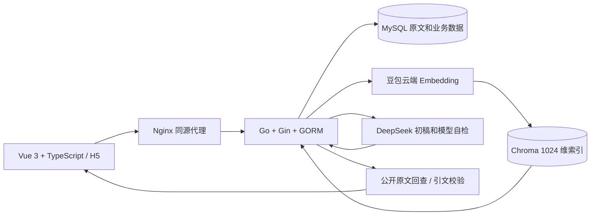

# MathWiki Lab · 数学与算法交互式维基论坛

把数学词条阅读、带来源的 AI 解释、连续追问和原文批注放在同一工作区。解决专业词条难懂、讨论与正文脱节、模型回答难核对的问题。正式项目名称：**一个基于大模型的数学与算法的交互式维基论坛**。

## 功能与边界

| 功能 | 当前实现 |
| --- | --- |
| 知识库 | 5,000 篇中文词条、48,845 个可见章节，保留来源、公式、表格与许可 |
| 搜索阅读 | MySQL 标题检索；搜索保留阅读和对话，点击结果才切换正文 |
| AI | DeepSeek 兼容接口、SSE 流式初稿、第二轮模型自检、原文引文校验 |
| RAG | 豆包云端 embedding、Chroma 1024 维检索、MySQL 原文回查；生产已建库 48,560 段 |
| 个性化追问 | 四档程度、四种讲法，本轮要求优先；指代追问附带有限上下文检索 |
| 社区与手机 | 选句批注、评论、收藏、审核及反馈；H5 列表 / 阅读 / AI 工作区 |
| 管理员授权 | 已有管理员授权 / 撤销他人，原因与审计、二次确认、旧会话失效 |
| 本轮保护 | 每账户同时一条回答、全局并发和每分钟配额；未配置语音时隐藏入口 |
| 可选适配 | Elasticsearch、豆包语音有适配代码，当前生产演示不启用 |

模型自检不保证数学结论正确；原文匹配不等于逻辑蕴含验证。每个章节最多取前 12,000 字后切分，当前 5 个长章节触及上限。章节数与向量片段数口径不同。

## 技术架构



生产使用原生 Go、Nginx 与 Docker MySQL / Chroma。Compose 是独立复现方案，不自动接管生产实例。云端运行模型与 embedding，本地不加载大模型权重。

## 安装运行：无云密钥的本地体验

依赖：Go 1.23 或更新兼容版本、Node.js 22.18+、pnpm 10.17.1。依赖清单和锁文件为 backend/go.mod、go.sum、frontend/package.json、pnpm-lock.yaml。Python 仅用于可选语料与文档工具。

```bash
git clone https://github.com/moonriver05/-.git mathwiki
cd mathwiki
```

终端一（Linux / macOS；SQLite 仅用于开发）：

```bash
cd backend
DATABASE_DRIVER=sqlite SQLITE_PATH=mathwiki-dev.db ELASTICSEARCH_ENABLED=false DEMO_SEED=true go run ./cmd/server
```

Windows PowerShell 的终端一：

```powershell
Set-Location backend
$env:DATABASE_DRIVER='sqlite'
$env:SQLITE_PATH='mathwiki-dev.db'
$env:ELASTICSEARCH_ENABLED='false'
$env:DEMO_SEED='true'
go run ./cmd/server
```

终端二：

```bash
cd frontend
corepack pnpm install --frozen-lockfile
corepack pnpm dev
```

访问 http://localhost:5173；健康检查 http://localhost:8080/health。没有模型密钥只展示明确标记的引用示例。注册需要 SMTP 验证，没有默认管理员。Windows 可复制 .env.example 为 .env，安装前端依赖后运行 ./scripts/dev.ps1 -Database sqlite。

**Go 程序不会自动加载 .env**，开发脚本会加载；手动运行需导出环境变量。数据库、SMTP、模型及管理员配置见 [完整环境指南](docs/environment.md)。

## Docker Compose：MySQL 路线

```bash
cp .env.example .env
# 编辑 MYSQL_PASSWORD、MYSQL_ROOT_PASSWORD；公开部署必须更换本地示例密码。
docker compose up -d --build
```

Windows 用 Copy-Item .env.example .env。默认只启动 web、api、mysql。启用 RAG 后另执行 docker compose --profile rag up -d；ES 需 --profile search-es 显式启动，不建议当前 2 GB 实例同时运行。

新安装使用命名卷。旧 E:/MathWikiData/mysql 安装需先备份，再使用 docker compose -f docker-compose.yml -f infrastructure/compose-legacy-bind.yml up -d --build 保留原挂载；已有账号密码必须匹配，修改变量不会修改库内密码。不要用 down -v 更新数据。

原生后端用 CHROMA_URL=http://127.0.0.1:8000；Compose 用 CHROMA_DOCKER_URL=http://chroma:8000，避免容器 localhost 误配。

## 数据、AI 与部署

- [公开快照导入](datasets/README.md)：8 个分片，导入空内容库，不分发账户与互动数据。
- [RAG 接入](docs/rag-deployment.md) / [全库建库](docs/rag-full-index.md)：先估算再建库，同内容已有片段跳过。
- [追问与程度更新](docs/conversation-retrieval-update.md) / [本轮上线说明](docs/review-release.md)。
- [账户](docs/accounts.md)、[媒体](docs/media-deployment.md)、[H5](docs/h5-deployment.md)。
- [网页管理员授权](docs/admin-roles.md)：首次管理员用命令行建立，后续在网页管理。

## 代码结构与质量

```text
backend/cmd/             服务、导入、索引和运维入口
backend/internal/api/    权限、审核、流式响应与业务接口
backend/internal/ai/     模型适配、教学约束、生成和自检
backend/internal/rag/    分块、检索、建库与原文校验
backend/internal/model/  数据模型；其他目录为邮件、存储等适配器
frontend/src/            Vue 工作区、组件、API 与流式处理
frontend/tests/          Node 交互及边界测试
datasets/               仅公开知识内容
infrastructure/         服务与兼容部署配置
docs/                   安装、设计、上线及提交材料
scripts/                开发、语料、发布检查与文档生成
```

```bash
go -C backend test ./...
go -C backend vet ./...
corepack pnpm --dir frontend test
corepack pnpm --dir frontend build
```

GitHub Actions 运行自动检查；Go 使用 gofmt，前端使用 TypeScript 类型检查。真实 MySQL / Chroma 集成测试需显式配置隔离实例；默认模拟云端协议不消耗 API 额度。[贡献规范](CONTRIBUTING.md)。

##  团队信息

团队称谓：珍姐姐后援会。

| 姓名 | 角色与分工 |
| --- | --- |
| 陈子扬 | 项目组长；需求分析、知识库结构、数据整理与词条规范化、统筹及文档 |
| 郑竣杰 | 系统架构、前后端开发、数据库设计、AI 集成、测试部署与维护 |
| 陈伟 | 指导教师；副教授，应用数学方向，负责理论指导 |

## 已经部署在阿里云上的公网链接

本项目目前暂时部署在阿里云上。

链接为 [MathWiki LAB](http://8.134.37.117/)

## 评审材料与许可

[技术文档](docs/submission/technical-report.docx)。

知识内容按出处保留 CC BY-SA 4.0 和修改说明；图片许可以原文件页为准。内容许可不自动覆盖代码或依赖。代码尚未指定开放源代码许可证，Public 可查看评审，不等于任意再利用授权。
